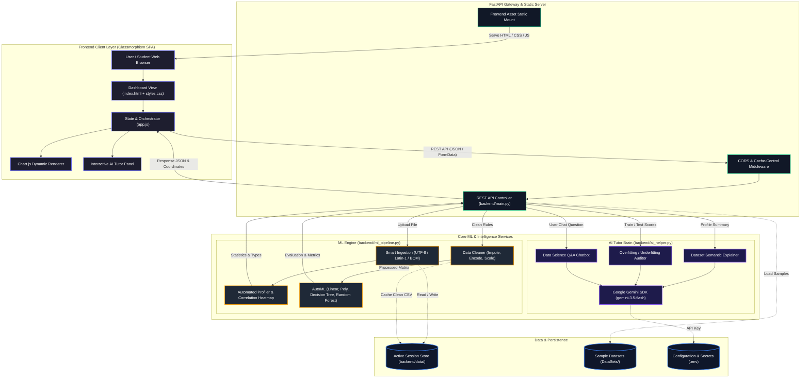

# 🧠 Friday (OmniML Brain)

> **No-Code Machine Learning Pipeline, Interactive Visualizations & AI Data Science Tutor**

[](https://www.python.org/downloads/)
[](https://fastapi.tiangolo.com/)
[](https://scikit-learn.org/)
[](https://aistudio.google.com/)
[](LICENSE)

**Friday (OmniML Brain)** is an educational, interactive web platform that democratizes machine learning for students and learners. Upload any dataset, and Friday will automatically profile the columns, clean and preprocess data, generate visualizations, train baseline machine learning models, and use **Google Gemini** as a built-in "AI Brain" tutor to explain what the statistics, plots, and evaluation metrics actually mean.

---

## ⚡ Quick Start: How to Run the Project

You only need **one single command** to run everything!

### 1. The One-Click Command

Clone the repository and run:

```bash
python run.py
```

### What `python run.py` does automatically:
1. 📦 Creates a isolated Python virtual environment (`.venv`) if one doesn't exist.
2. 📥 Installs all required packages from `backend/requirements.txt`.
3. 🔎 Finds an available port on your machine (starting at `8000`).
4. 🚀 Boots the FastAPI / Uvicorn server.
5. 🌐 Automatically opens your web browser to `http://127.0.0.1:8000`.

---

## 🔑 Setting up the Gemini AI Tutor (Optional)

Friday includes an AI tutor powered by Google Gemini. While core data profiling and AutoML work offline without a key, configuring the key unlocks AI dataset insights, audit reports, and the interactive chatbot:

1. Get a free API key from [Google AI Studio](https://aistudio.google.com/).
2. Create a `.env` file in the project root:
   ```bash
   cp .env.example .env
   ```
3. Add your key inside `.env`:
   ```env
   GEMINI_API_KEY=your_gemini_api_key_here
   ```
*(Alternatively, you can enter or update your API key directly in the top-right settings modal on the web interface at any time!)*

---

## 🛠️ Manual Setup (Alternative)

If you prefer to activate your own virtual environment manually:

```bash
# 1. Create and activate a virtual environment
python -m venv .venv

# Windows (PowerShell):
.venv\Scripts\Activate.ps1
# Windows (CMD):
.venv\Scripts\activate.bat
# macOS / Linux:
source .venv/bin/activate

# 2. Install dependencies
pip install -r backend/requirements.txt

# 3. Start the FastAPI backend
uvicorn backend.main:app --host 127.0.0.1 --port 8000 --reload
```

Then visit [http://127.0.0.1:8000](http://127.0.0.1:8000) in your browser.

---

## ✨ Key Features

### 1. 📂 Universal Dataset Ingestion & Profiling
- Drag-and-drop CSV or Excel (`.xls`, `.xlsx`) files up to 150MB.
- **Robust Multi-Encoding Support**: Automatic fallback handling (`UTF-8` $\rightarrow$ `Latin-1` $\rightarrow$ `UTF-8 with BOM`) prevents crashes on datasets with special symbols.
- Instant statistics: Column data types, row counts, unique values, missing value rates, distribution percentiles, and an interactive correlation matrix.

### 2. 🧹 Interactive No-Code Data Cleaning
- **Imputation**: Fill missing values using Mean, Median, Mode, or Constant values.
- **Categorical Encoding**: Convert text columns into numbers using Label Encoding or One-Hot Encoding.
- **Feature Scaling**: Apply standard normalization (`StandardScaler`) or min-max normalization (`MinMaxScaler`).
- **Feature Selection**: Drop redundant or high-cardinality ID columns before fitting models.
- Download cleaned datasets with one click.

### 3. 📈 Custom Visualization Studio
- Build plots on the fly without writing Matplotlib or Seaborn code.
- Supported chart types: **Scatter Plots**, **Line Charts**, **Histograms**, **Bar Charts**, and **Correlation Heatmaps**.
- Powered by Chart.js with fluid tooltips, zooming, and dark-theme aesthetic charts.

### 4. 🤖 AutoML Model Training & Leaderboard
- **Task Auto-Detection**: Automatically determines whether a problem is **Regression** or **Classification** based on target column distribution and data type.
- **Parallel Multi-Model Training**:
  - 📏 **Linear / Logistic Regression** (with convergence optimization)
  - 📐 **Polynomial Regression** (degree-2 polynomial feature mapping)
  - 🌲 **Decision Trees** (with readable if-then logic rule extraction)
  - 🌳 **Random Forest** (ensemble learning with feature importance rankings)
- **Interactive Evaluation**:
  - Regression: $R^2$ Score, Mean Absolute Error (MAE), Mean Squared Error (MSE), Actual vs. Predicted plots, and Residual analysis.
  - Classification: Accuracy, Precision, Recall, F1-Score, interactive visual Confusion Matrix, and Feature Importance bar charts.

### 5. 🧠 Gemini AI Tutor Brain
- **Dataset Analysis**: Explains what the dataset represents in plain English, identifies potential targets, and suggests interesting visualizations.
- **Automated Model Audit**: Evaluates train vs. test metrics to diagnose **overfitting**, **underfitting**, or **data leakage**, teaching students why a model performed the way it did.
- **Data Science Chat**: Ask questions like *"Why is Decision Tree performing better than Linear Regression on this data?"* or *"What does negative R2 mean?"* and get clear answers.

---

## 🏗️ System Architecture

### 1. High-Level Component & Service Flowchart



### 2. End-to-End Pipeline Execution Flowchart

```mermaid
flowchart LR
    Ingest["1. Ingest Data\n(CSV / Excel Drag & Drop)"] --> Resolve["2. Resolve Encoding\n(UTF-8 / Latin-1 / BOM)"]
    Resolve --> Profile["3. EDA & Profiling\n(Stats, Nulls, Correlation)"]
    Profile --> Clean["4. Clean & Preprocess\n(Impute, Scale, One-Hot)"]
    Clean --> Detect["5. Task Auto-Detect\n(Regression vs Classification)"]
    Detect --> Train["6. AutoML Fit\n(Linear, Poly, Tree, Forest)"]
    Train --> Eval["7. Multi-Metric Eval\n(R2, MAE, Acc, Confusion Matrix)"]
    Eval --> Audit["8. Gemini AI Tutor Audit\n(Overfitting Diagnosis & Report)"]
    Audit --> Visualize["9. Dynamic Plots\n(Chart.js Custom Studio)"]
```



---

## 📂 Project Architecture

```
Friday/
├── run.py                 # Self-bootstrapping one-click launcher
├── .env.example           # Template for environment credentials
├── .gitignore             # Protects keys, virtual envs, and temporary data
├── README.md              # Project documentation
│
├── backend/
│   ├── main.py            # FastAPI REST API & static file router
│   ├── ml_pipeline.py     # AutoML training, profiling, and cleaning pipeline
│   ├── ai_helper.py       # Google Gemini LLM brain & prompt engineering
│   ├── requirements.txt   # Python package dependencies
│   ├── list_models.py     # Diagnostic tool to verify supported Gemini models
│   ├── test_pipeline.py   # Unit tests for preprocessing & ML algorithms
│   └── test_api_flow.py   # End-to-end integration tests
│
├── frontend/
│   ├── index.html         # Modern single-page web app with glassmorphism UI
│   ├── css/
│   │   └── styles.css     # Dark-theme Obsidian design system & animations
│   └── js/
│       └── app.js         # Reactive frontend controller & Chart.js rendering
│
└── DataSets/              # 50+ diverse sample CSV datasets for testing
    ├── iris.csv           # Classification benchmark
    ├── bike.csv           # Regression benchmark
    ├── housing.csv        # Real estate pricing
    └── ...
```

---

## 🧪 Testing

To verify the machine learning algorithms and API routes locally:

```bash
# Run ML pipeline unit tests
python -m unittest backend/test_pipeline.py

# Run API end-to-end flow test (while server is running)
python -m backend.test_api_flow
```

---

## 🤝 Contributing

Contributions, issues, and feature ideas are welcome! Feel free to:
1. Fork the Project.
2. Create your Feature Branch (`git checkout -b feature/NewAlgorithm`).
3. Commit your Changes (`git commit -m "Add KNN and SVM algorithms"`).
4. Push to the Branch (`git push origin feature/NewAlgorithm`).
5. Open a Pull Request.

---

## 📜 License

Distributed under the MIT License. See `LICENSE` for more information.
